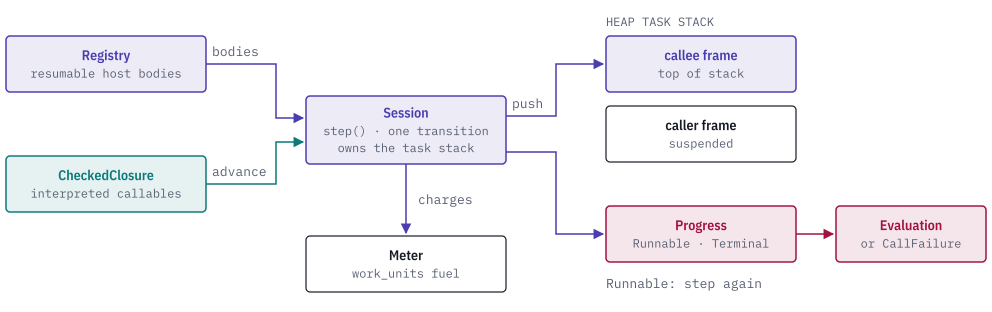

# quire-eval

[](https://discord.gg/k8DVhuYBR2)
[](https://github.com/agent-ix/quire-spec-language)

quire-eval is a `no_std` Rust workspace with the checked terms an evaluator reads (`quire-checked`) and the evaluation core that runs them (`quire-eval`).

`quire-eval` begins the application of a checked closure, steps the resulting session one finite transition at a time, and runs registered host bodies next to interpreted code on one heap task stack. Evaluation is bounded by the `work_units` fuel of a single `quire_exact::Meter`, and a session ends with an evaluation or a call failure. `quire-checked` holds the checked node vocabulary, declaration keys and the admitted integer-division law that the evaluator and the checker share.

<picture>
  <source media="(prefers-color-scheme: dark)" srcset="docs/images/hero-dark.svg">
  
</picture>

## Getting started

Add the crates as git dependencies. Both build without `std`.

```toml
[dependencies]
quire-eval = { git = "https://github.com/agent-ix/quire-eval", branch = "main" }
quire-checked = { git = "https://github.com/agent-ix/quire-eval", branch = "main", default-features = false }
```

To work from a clone, install the Rust toolchain pinned in `rust-toolchain.toml` (it includes the `thumbv7em-none-eabi` target) and run `make ci`.

## Usage

An evaluator implements `CheckedClosure` for its checked terms. A caller registers host bodies in a `Registry`, begins a call, and steps the session until it ends:

```rust
use quire_eval::{CallFailure, CheckedClosure, Evaluation, Progress, Registry};
use quire_exact::{Meter, NodeKey, Value};

fn call<C: CheckedClosure>(
    registry: &mut Registry<C>,
    callable: NodeKey,
    arguments: Vec<Value>,
    environment: &C::Environment,
    meter: &mut Meter,
) -> Result<Evaluation, CallFailure> {
    let mut session = registry.begin_call(callable, arguments, environment, meter)?;
    loop {
        match session.step() {
            Progress::Runnable(next) => session = next,
            Progress::Terminal(result) => return result,
        }
    }
}
```

The first successful `begin_call` seals the registry. `Session::run` performs the same loop.

A host body implements `Body`. Each call to `resume` runs one transition and returns `Transition::Continue`, `Transition::Call` with a `ChildRequest` for a callee, or `Transition::Done` with the body's `Evaluation`. The scheduler validates the request, charges `function.call`, runs the callee and delivers its result to the suspended body once.

## Reference

| Item | Crate | Purpose |
| --- | --- | --- |
| `CheckedClosure` | `quire-eval` | The contract an evaluator implements for one checked closure: signatures, admission and interpreted transitions. |
| `Registry` | `quire-eval` | Binds a `BodyFactory` to a callable and signature the closure admitted, and begins calls and expression evaluations. |
| `Admission` | `quire-eval` | The typed result of registering a body: accepted, sealed, not admitted, signature mismatch or duplicate binding. |
| `Session`, `Progress` | `quire-eval` | The live application and the result of one step: `Runnable` or `Terminal`. |
| `Body`, `BodyFactory`, `ChildRequest`, `Resume`, `Transition` | `quire-eval` | The resumable host body contract. |
| `Evaluation`, `FamilyOutcome`, `CallFailure` | `quire-eval` | The evaluation result vocabulary. |
| `NodeKind`, `NodeRead` | `quire-checked` | The checked expression node vocabulary and how an evaluator reads a node. |
| `DeclarationKey` | `quire-checked` | The declaration identity a domain package supplies. |
| `AdmittedIntegerDivision` | `quire-checked` | The admitted `div` and `rem` law of a checked package. |

The `construct` feature of `quire-checked` exposes the constructors of checked terms. The checker enables it, and it is the checking authority.

## Ecosystem

<picture>
  <source media="(prefers-color-scheme: dark)" srcset="docs/images/ecosystem-dark.svg">
  
</picture>

## Building and testing

```
make fmt-check       # formatting
make lint            # clippy, warnings are errors
make test            # cargo test, default and all features
make build-no-std    # build for thumbv7em-none-eabi
make deny            # license and source policy
make docs            # rustdoc, warnings are errors
make ci              # every gate above
```

## Contributing

Read [CONTRIBUTING.md](CONTRIBUTING.md) and sign the [CLA](CLA.md) before opening a pull request. Questions are welcome on [Discord](https://discord.gg/k8DVhuYBR2).

## License

AGPL-3.0-or-later. See [LICENSE](LICENSE) and [CONTENT_RIGHTS.md](CONTENT_RIGHTS.md).
